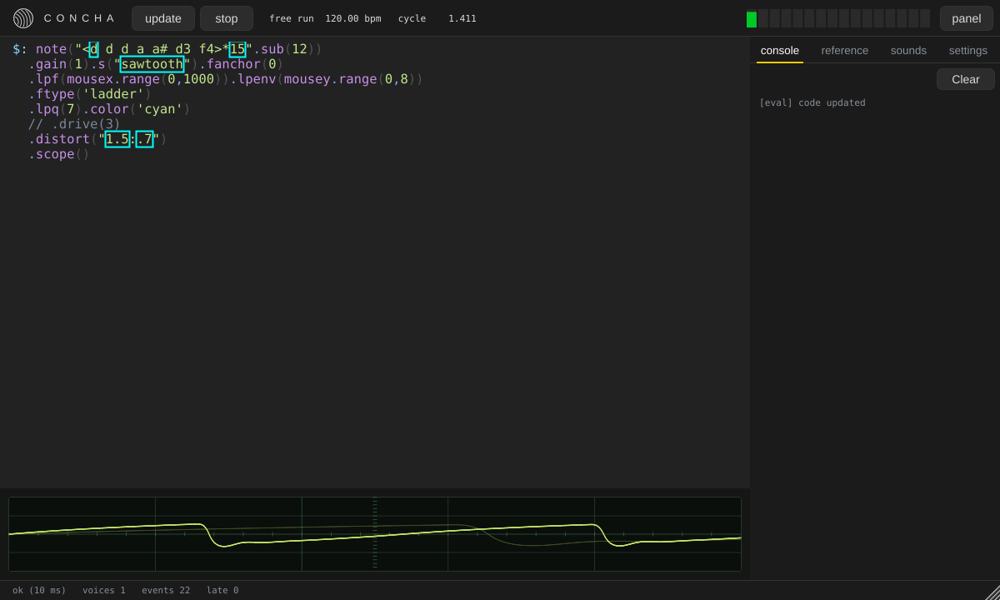

# Concha

### Live-code your music, right inside your DAW.

Concha brings [Strudel](https://strudel.cc), the joyful live-coding language, into your favourite
DAW as a **CLAP and VST3 plug-in**. Type a few lines, hit Ctrl+Enter, and your patterns play in perfect
time with your song.

## Why you'll love it

🎛️ **Every part on its own track.** Concha has 16 stereo outputs. Send drums, bass and pads to
separate channels and mix them with your own effects.

🎹 **MIDI in and out.** Play any synth or hardware from your code. Turn the knobs of your controller
and hear the sound change instantly, even in the middle of a note.

📁 **Your samples, in a click.** Point Concha to the sample folders on your drive, give them a name,
and play them right away.

✨ **All of Strudel.** The same language, the same sounds and effects, and the same friendly editor
as strudel.cc. No browser, no server, nothing else to install.

## Get it

Download the latest version from the [Releases](../../releases) page, copy the plug-in into your
plug-in folder, and open it in your DAW.

Linux today (Ubuntu 22.04 and later). Windows and macOS are coming.

---

Free and open source under the AGPL-3.0, like Strudel.
