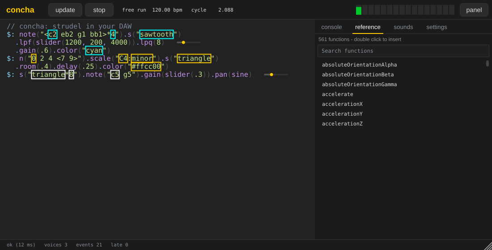

# Phase 5 — the editor (18 November 2026)

Concha's window now works like strudel.cc's REPL. The choices made with you: JUCE's code editor
extended (not a hand-written one), strudel.cc's default theme, the code with a side panel of tabs,
the interface in English.

## What is new

| Part | Where | Detail |
|---|---|---|
| **Code editor** | `src/plugin/ui/CodeView` | JUCE's `CodeEditorComponent` (selection, undo, clipboard, scrolling), painted in software (since phase 8: OpenGL froze typing on Linux), with what strudel.cc's CodeMirror setup adds: **Ctrl/Alt+Enter** evaluates, **Ctrl/Alt+.** stops, the code **flashes** on evaluation (200 ms), **Ctrl+/** toggles comments, Tab indents by 2. |
| **Highlighting** | `src/plugin/ui/JsTokeniser`, `Theme` | strudel.cc's default theme (`strudel-theme.mjs`) with the token kinds its lezer JavaScript grammar gives: keywords, definitions (`const x`), labels (`$:`), calls and properties, numbers, strings, comments, operators, brackets, punctuation. |
| **Playing notes** | `PatternWorker::activeHaps`, `CodeView::setPlaying` | As `highlight.mjs`: the mini-notation ranges of the haps playing now are outlined (2 px) in their `.color()` or the foreground. The ranges follow the edits made after the evaluation, as CodeMirror maps its decorations. The pattern thread keeps the queried haps with their code ranges; the editor picks the ones playing at the DAW's position, 60 times a second. |
| **Sliders** | `CodeView::setSliders` | `slider(value, min, max, step)` gets a 64 px slider, as in strudel.cc. Moving it rewrites the value in the code and changes it live, without evaluating (`setSlider` on the playing engine). One difference: JUCE's editor cannot put a widget inside a line, so the slider sits at the end of its line. |
| **Completion** | `CodeView::Completion`, `DocIndex` | Typing a name opens the list of Strudel's functions that match (prefix first), with the selected one's documentation next to it. Arrows choose, Enter or Tab inserts, Esc closes, **Ctrl+Space** opens it on demand. |
| **Reference** | `ReferencePanel`, `js/tools/gen-docs.mjs` | 561 functions with synonyms, description, parameters and examples. They are extracted at build time from the JSDoc of Strudel's packages by a small reader, without downloading `jsdoc`, and compiled into the binary. The tab follows the function under the caret; double click inserts a name. |
| **Sounds** | `SoundsPanel` | The sounds known to the playing code (synths, loaded samples, banks), with a search box; double click inserts a name. "Sample folders..." opens the named folders' panel (now in English). |
| **Settings** | `SettingsPanel` | Beats per cycle, Free run, Sync probe; font size, highlighting, flash, completion, line numbers. They are saved with the project, as are the window size and the open tab. |
| **Interface zoom** (added after phase 8) | `ui/UiZoom`, `ConchaEditor` | The whole interface scales, from 100 to 250 % (Settings, or Ctrl + `=` / `-` / `0`). The text is drawn again at its size, so it stays sharp. The setting belongs to the computer, not the project (`~/.config/Concha/ui.txt`). Auto follows the system's scale, which JUCE does not apply to plug-in windows on Linux: the host's scale when it gives one, else `Xft.dpi`, `GDK_SCALE`, `QT_SCALE_FACTOR`, else KDE's or GNOME's monitor configuration. The window keeps its logical size and grows with the zoom. |
| **Console** | `ConsolePanel` | Strudel's messages, warnings and errors. An error brings the console forward. |
| **Meters** | `Meters` | The peaks of the 16 outputs (Main, Orbit 2 to 16) in the top bar. |

If the DAW loads a project or a preset while the window is open, the editor shows the new code.

## Tests

- `ctest`: 4 suites, all passing. The new one, `ui`, covers:
  - the tokeniser;
  - CSS colours;
  - the function index and the completion order;
  - a playing range followed after an edit, checked on the painted pixels;
  - a slider rewriting its value in the code;
  - Ctrl+/;
  - completion accepted with Enter.
- `build/concha_ui_shot code.js out.png [w h] [ms] [tab] [text to type]`: renders the window off screen to a PNG, with the code playing (free run). It checks the interface without a DAW or a window on the screen (the image above comes from it). It reads your sample folders but never writes them.

## What remains

- **To test in Bitwig**: the keyboard shortcuts (the host may take some keys), resizing, a reloaded project.
- **Not done**:
  - Alt+w / Alt+q (jump between `$:` blocks);
  - previewing a sound by clicking it in the Sounds tab;
  - showing an error's position in the code;
  - visual widgets inside the code (`._pianoroll()`, `._scope()`): those belong to phase 8.
