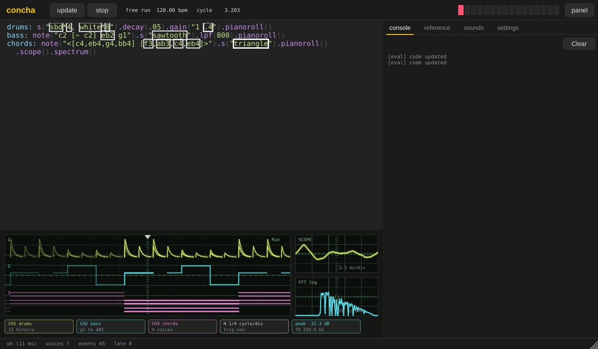
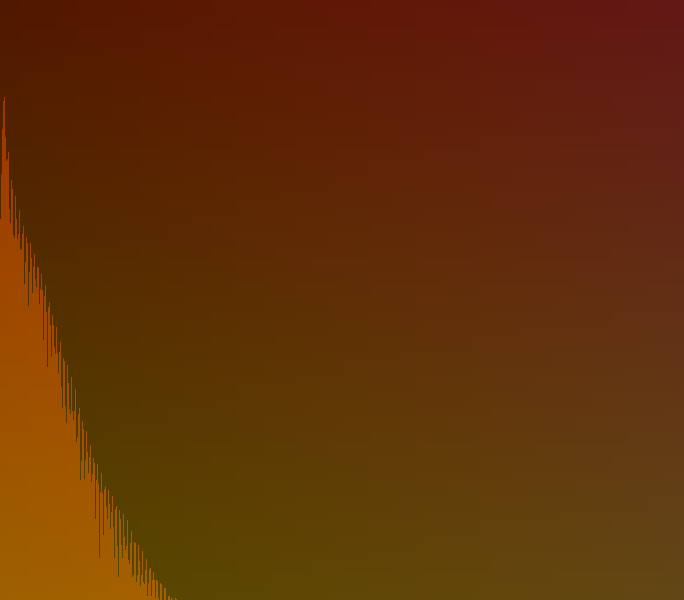

# Phase 8 — visuals (18 November 2026)

Strudel's visuals, redrawn as a laboratory oscilloscope, and shaders, which are Concha's own.



## Strudel's visuals: the oscilloscope band

The first version ran Strudel's drawing code as is and replayed it in software. The window was then
repainted entirely, code included, 60 times a second, which slowed the whole interface down. They are
now drawn natively, in a band under the code that only exists when the code asks for it.

| Part | Where | Detail |
|---|---|---|
| **When** | `js/src/visuals.mjs`, `ConchaEditor` | The band appears only when the code calls a visual, and disappears with the next evaluation that calls none. Its content follows the calls:<ul><li>`.pianoroll()`, `.punchcard()`, `.wordfall()`, `.spiral()`, `.pitchwheel()` (and their inline forms `._pianoroll()`…) give the main screen, with **one channel per `$:` block** that calls them (`all(pianoroll)`: every block);</li><li>`.scope()` / `._scope()` gives the SCOPE screen;</li><li>`.spectrum()` / `.fscope()` / `._spectrum()` gives the FFT screen.</li></ul> |
| **Main screen** | `src/plugin/ui/ScopeStrip` | A graticule of 10 × 8 divisions with graduated axes, at 1/4 cycle per division. The trigger mark (▼) is the present, at the centre. What has played stays on the left, dimmed and fading, as a phosphor's afterglow. Each channel has the colour of a multi-channel oscilloscope (yellow, cyan, magenta, green…):<ul><li>drums are **pulses** with their decay, taller for a kick than for a hi-hat, scaled by gain;</li><li>a melody is a **step trace** whose height is the pitch;</li><li>chords show **one segment per note**.</li></ul> |
| **SCOPE / FFT** | `ScopeStrip`, `ConchaProcessor::uiAnalyser` | SCOPE is the analysed sound (`.analyze(id)`, as Strudel), aligned on a rising zero crossing, with the previous trace in afterglow and its ms/div. FFT is its spectrum on a logarithmic axis from 20 Hz to 20 kHz, -100..0 dB, with the peak and its frequency. |
| **Readouts** | `ScopeStrip::paint` | One box per channel (the block's name from the code: `drums:`, `$1`…; hits per cycle, pitch range or number of voices), then the time base and the screens' values. |
| **Efficiency** | `ScopeStrip::paint`, `PatternWorker::runChannelQueries` | Painted in software, 30 times a second, like the rest of the window. The screens and graticules are drawn once into an image; each frame adds the traces (a few batched paths with a faint halo) and the texts. The channels' haps come from short queries on the pattern thread, up to 1.5 cycles ahead, and only while the window is open. No JS runs per frame, and there is no third JS engine for these visuals. Measured: the band (3 channels, SCOPE and FFT) costs about 20 % of a core and never delays typing. |
| **A user's own drawing** | `js/src/canvas.mjs`, `src/plugin/ui/Canvas2D`, `PatternWorker::visualLoop` | `.draw()`, `.onPaint()` and `animate()` written in the code keep Strudel's canvas behind the code, replayed by the window. Their JS engine on its own thread only starts when the code uses them. |

## Why not OpenGL (except for shaders)

The first band was drawn with OpenGL. On Linux, in a plug-in window, it froze the interface. Measured
with live typing (20 keys a second while a loop plays):

- before: the message thread was 500 to 800 ms late every 50 ms, and only 13 to 20 keys of 200 got through;
- after: 0.3 ms without the band, 0.8 ms with it, and all 200 keys got through.

Two causes, seen in the threads' stacks:

1. JUCE's OpenGL context painted the components on its thread while holding the message thread's lock.
2. Activating a context takes the X11 lock, and the driver (Mesa, dri3) waits under it for the display
   server to release a buffer.

The editor is now painted in software. The band is painted in software too. A shader still needs
OpenGL behind the code: the context is attached only while a shader is declared, without vsync
(`setSwapInterval(0)`), so the driver does not wait under the lock. With a shader: 200 keys of 200,
2.8 ms late on average.

## Shaders (Concha's own)

```js
shader`
uniform float kick;
void mainImage(out vec4 fragColor, in vec2 fragCoord) {
  vec2 uv = fragCoord / iResolution.xy;
  float fft = texture2D(iChannel0, vec2(uv.x, 0.25)).r;   // the output's spectrum
  vec3 col = 0.5 + 0.5 * cos(iTime + uv.xyx + vec3(0, 2, 4));
  col *= 0.35 + 0.4 * exp(-kick * 6.0);                    // flashes on each kick
  if (uv.y < fft) col += vec3(0.3, 0.1, 0.0);
  fragColor = vec4(col, 1.0);
}`
$: s("sawtooth*4").note("c2 c3").uniform("kick")
```

| Part | Where | Detail |
|---|---|---|
| **Syntax** | `js/src/visuals.mjs` | ``shader`...` `` sets a GLSL fragment shader, drawn behind the code and the canvases. Text in backticks is mini-notation for Strudel's transpiler, so `shader` and `glsl` are **language literals**, as ``mondo`...` `` is: their text arrives untouched. `shader(glsl`...`)` and `shader('...')` also work. A new evaluation without a shader removes it. |
| **Shadertoy conventions** | `src/plugin/ui/ShaderLayer` | `mainImage(out vec4 fragColor, in vec2 fragCoord)`, or your own `main()`. Uniforms:<ul><li>`iResolution`;</li><li>`iTime` (seconds, from the DAW's position);</li><li>`iCycle`, `iCps`, `iFrame`;</li><li>`iChannel0`: 512 × 2, the output's spectrum on row 0 and its waveform on row 1, in `.r`, as Shadertoy's audio input (fftSize 1024, smoothing 0.8, -100..-30 dB).</li></ul> |
| **Driven by the pattern** | `ConchaEditor::updateShader` | `.uniform("name")` on a pattern feeds `uniform float name;` (seconds since its last onset) and `uniform float name_v;` (gain × velocity). |
| **Rendering** | `ConchaEditor::renderOpenGL` | In the window's OpenGL context, attached only while a shader is declared (without vsync), before JUCE paints the components on top. Compile errors go to the console. |



Hydra (`@strudel/hydra`) is not embedded: shaders take its place, as planned.

## Tests

- `ctest`: 5 suites, all passing. New:
  - `.pianoroll()` and `._punchcard()` mark their haps without drawing in JS, `.scope()` and `.spectrum()` ask for their screens, and a user's own `.draw()` still records its canvas;
  - Canvas2D: fill, translucent stroke, persistence, `getImageData`/`putImageData` that scroll, a translated arc;
  - colours `hsl`/`transparent`;
  - an analyser: capture after postgain, ids sharing slots, the spectrum's peak on the right bin, the main output;
  - ``shader`...` ``: the GLSL text arrives untouched, with no mini-notation inside.
- `concha_ui_shot` renders the window off screen. With `CONCHA_SHOT_GL=1`, it opens a real window placed off screen and draws its snapshot over OpenGL's last frame (the shader). With `CONCHA_SHOT_TYPING=1`, it types 20 keys a second while the code plays, and reports the time per key and how late the message thread is.
- The pattern parity suite: 0 differences in 546 cases. 15 new known differences, all the same one: Strudel's test runtime makes `._scope()`/`._spectrum()` do nothing, while on strudel.cc (and in Concha) they add `analyze` to the haps. The superdough comparison: 111/111.

## To test in Bitwig

- the band while the DAW plays, loops and jumps, and resizing the window;
- a shader (with the GPU of your machine).
