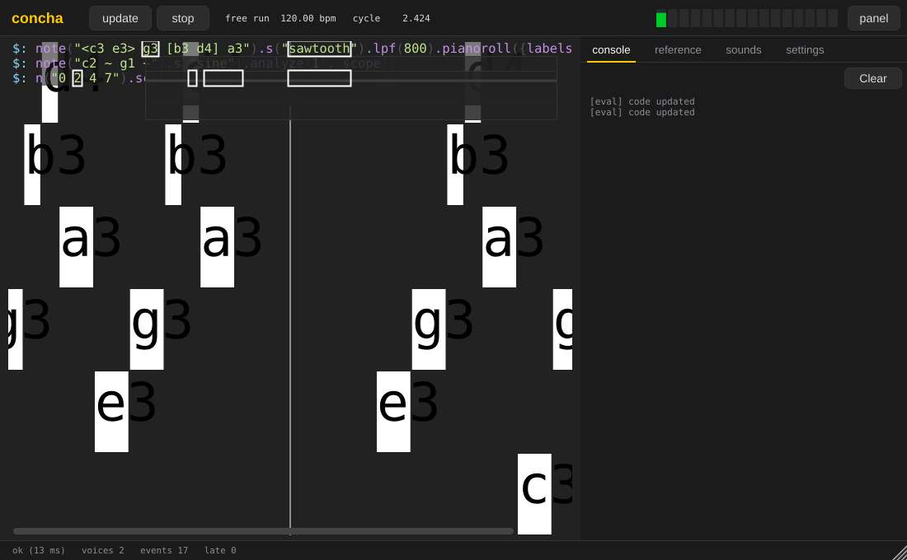
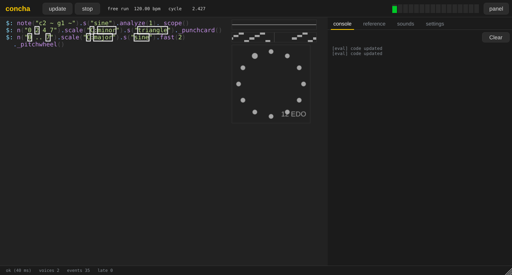

# Phase 8 — visuals (18 November 2026)

Strudel's visuals, drawn by Strudel's own code, and shaders, which are Concha's own.



## Strudel's visuals

| Part | Where | Detail |
|---|---|---|
| **Same code as strudel.cc** | `js/src/visuals.mjs`, `js/src/canvas.mjs` | `@strudel/draw` (`pianoroll`, `punchcard`, `wordfall`, `spiral`, `pitchwheel`, `animate`, `.draw()`, `.onPaint()`) and webaudio's `scope`/`tscope`, `fscope`, `spectrum` run **unchanged**. Concha gives them what the browser would: `document`, canvases, `requestAnimationFrame`, `getComputedStyle`, the window's size. Each canvas records its Canvas 2D calls (fills, strokes, paths, arcs, ellipses, texts, transforms, `getImageData`/`putImageData`…) as numbers. |
| **Replayed in the window** | `src/plugin/ui/Canvas2D` | The window replays those calls on an image per canvas, which **persists from frame to frame** as a browser canvas does. This is why the spectrum scrolls and the smear of `scope({smear})` fades. Colours: names, `#hex`, `rgb(a)`, `hsl(a)`, `transparent`. |
| **Own thread, own JS engine** | `PatternWorker::visualLoop` | The animations run in a third QuickJS engine, which evaluates the same code (patterns are deterministic) and is never asked for sound. They run at 60 frames a second while the window is open, at the DAW's position. A slow frame (up to 460 ms measured on the first ones) never delays the music: with frames on the pattern thread, events came late. |
| **Painters** | `js/src/concha.mjs` (`startPainters`) | `punchcard`, `wordfall` and `pitchwheel` paint through `.onPaint()`. As strudel.cc's editor does, a `Drawer` runs them with a window of [-2, 2] cycles. |
| **Background** | `CodeView::paint` | `.pianoroll()`, `.spiral()`, `.scope()`… draw behind the code, as on strudel.cc. While something is drawn, the code's lines get the theme's translucent background (`lineBackground`). A new evaluation starts from empty canvases (`cleanupDraw`). |
| **Inline widgets** | `CodeView::paintWidgets` | `._pianoroll()`, `._punchcard()`, `._spiral()`, `._scope()`, `._pitchwheel()`, `._spectrum()` (strudel.cc's `widget.mjs`, same sizes). **Difference**: strudel.cc opens a block under the line, which JUCE's editor cannot do. The widgets stand in a column at the right of the code, each at the height of its line, shrunk to the room left; when the code is too wide, they overlap its right side on a dark background. |
| **Analysers** | `src/superdough/Analyser`, `Engine` | `.analyze(id)` (which `scope` and `spectrum` add) sends the voice after postgain, in mono, to its analyser, as superdough's `effectSend(post, analyser)`. The size is `2^(fft + 5)`. Time data is the start of the latest window, as WebAudio returns it; frequency data uses a Blackman window, the FFT, smoothing 0.5 and dB. An id can be a number or the widget's name: both share 15 slots. |



## Shaders (Concha's own)

```js
shader`
uniform float kick;
void mainImage(out vec4 fragColor, in vec2 fragCoord) {
  vec2 uv = fragCoord / iResolution.xy;
  float fft = texture2D(iChannel0, vec2(uv.x, 0.25)).r;   // the output's spectrum
  vec3 col = 0.5 + 0.5 * cos(iTime + uv.xyx + vec3(0, 2, 4));
  col *= 0.35 + 0.4 * exp(-kick * 6.0);                    // flashes on each kick
  if (uv.y < fft) col += vec3(0.3, 0.1, 0.0);
  fragColor = vec4(col, 1.0);
}`
$: s("sawtooth*4").note("c2 c3").uniform("kick")
```

| Part | Where | Detail |
|---|---|---|
| **Syntax** | `js/src/visuals.mjs` | ``shader`...` `` sets a GLSL fragment shader, drawn behind the code and the canvases. Text in backticks is mini-notation for Strudel's transpiler, so `shader` and `glsl` are **language literals**, as ``mondo`...` `` is: their text arrives untouched. `shader(glsl`...`)` and `shader('...')` also work. A new evaluation without a shader removes it. |
| **Shadertoy conventions** | `src/plugin/ui/ShaderLayer` | `mainImage(out vec4 fragColor, in vec2 fragCoord)`, or your own `main()`. Uniforms:<ul><li>`iResolution`;</li><li>`iTime` (seconds, from the DAW's position);</li><li>`iCycle`, `iCps`, `iFrame`;</li><li>`iChannel0`: 512 × 2, the output's spectrum on row 0 and its waveform on row 1, in `.r`, as Shadertoy's audio input (fftSize 1024, smoothing 0.8, -100..-30 dB).</li></ul> |
| **Driven by the pattern** | `ConchaEditor::updateShader` | `.uniform("name")` on a pattern feeds `uniform float name;` (seconds since its last onset) and `uniform float name_v;` (gain × velocity). |
| **Rendering** | `ConchaEditor::renderOpenGL` | In the window's OpenGL context, before JUCE paints the components on top. Compile errors go to the console. |


Hydra (`@strudel/hydra`) is not embedded: shaders take its place, as planned.

## Tests

- `ctest`: 5 suites, all passing. New:
  - a pianoroll and an inline widget record their canvas calls, and the old animations stop on a new evaluation;
  - Canvas2D: fill, translucent stroke, persistence, `getImageData`/`putImageData` that scroll, a translated arc;
  - colours `hsl`/`transparent`;
  - an analyser: capture after postgain, ids sharing slots, the spectrum's peak on the right bin, the main output;
  - ``shader`...` ``: the GLSL text arrives untouched, with no mini-notation inside.
- `concha_ui_shot` renders the visuals off screen (the images above). With `CONCHA_SHOT_SHADER=<file.png>`, it opens a real OpenGL window placed off screen and writes the shader layer's last frame (the third image).
- The pattern parity suite: 0 differences in 546 cases. 15 new known differences, all the same one: Strudel's test runtime makes `._scope()`/`._spectrum()` do nothing, while on strudel.cc (and in Concha) they add `analyze` to the haps. The superdough comparison: 111/111.

## To test in Bitwig

- the background and the widgets while the DAW plays, resizing the window;
- a shader (with the GPU of your machine);
- the cost: a busy pianoroll costs its JS engine a few ms per frame, on its own thread.
